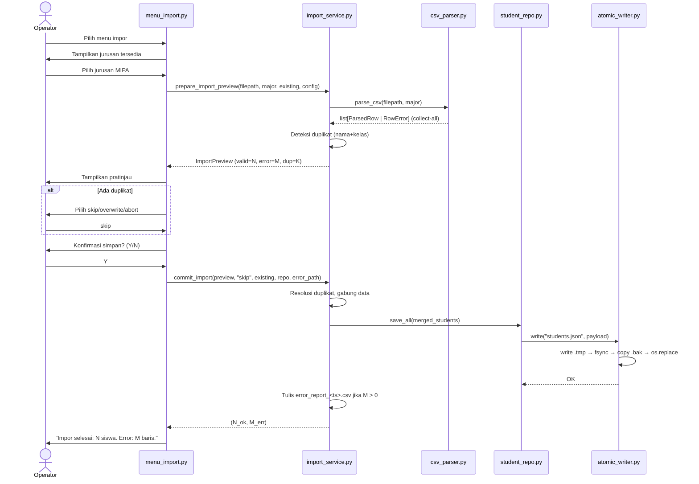

# Dokumen Desain Teknis (Technical Design Document)
**Sistem Pemeringkatan Siswa Eligible SNBP (Eligo)**
**Versi:** 1.0 | **Tanggal:** 25 Oktober 2026 | **Peran:** Principal Software Architect
**Status:** Menunggu Persetujuan | **Referensi:** `.kiro/specs/snbp-ranking/requirements.md` v1.0

---

## Daftar Isi

1. [Overview](#1-overview)
2. [Design Goals dan Prinsip](#2-design-goals-dan-prinsip)
3. [Architecture](#3-architecture)
4. [Components and Interfaces](#4-components-and-interfaces)
5. [Data Models](#5-data-models)
6. [Error Handling](#6-error-handling)
7. [Testing Strategy](#7-testing-strategy)
8. [Architecture Decision Records](#8-architecture-decision-records-adr)
9. [Traceability Matrix](#9-traceability-matrix-requirement--komponen--test)
10. [Risiko Teknis dan Mitigasi](#10-risiko-teknis-dan-mitigasi)
11. [Self-Review Arsitek](#11-self-review-arsitek)

---

## 1. Overview

### 1.1 Tujuan Desain

Dokumen ini mendefinisikan desain teknis sistem **Eligo** — aplikasi terminal berbasis Python 3.11+ untuk pemeringkatan siswa eligible SNBP. Setiap keputusan desain mengacu pada kebutuhan yang teridentifikasi di `requirements.md` v1.0 dan delapan batasan keras rekayasa (C1–C8). Tidak ada komponen yang ditambahkan tanpa justifikasi tertulis yang dapat ditelusuri ke requirement atau NFR.

### 1.2 Batasan Desain (Non-Negotiable)

| Batasan | Mekanisme Desain | Sumber |
|---|---|---|
| `Decimal`, bukan `float` | Seluruh aritmetika skor menggunakan `decimal.Decimal` dengan `ROUND_HALF_UP` | Asumsi 3.2, REQ-06 |
| Merge Sort mandiri | `domain/sorter.py` mengimplementasikan merge sort sendiri; `sorted()` dilarang di produksi | C3, REQ-06 |
| Atomic write + `.bak` | `atomic_writer.py`: `.tmp` → `fsync` → `.bak` copy → `os.replace` | C5, REQ-13 |
| Parameter di `config.json` | `config_service.py` membaca dan memvalidasi semua angka bisnis | C6 |
| Dependency rule satu arah | Presentation → Application → Domain ← Infrastructure | C8, NFR Kode |

### 1.3 Fakta Teknis Kunci

| Fakta | Nilai | Sumber |
|---|---|---|
| Bahasa | Python 3.11+ | C1 |
| Dependensi runtime | `rich`, `pytest` saja | C1 |
| Tipe skor | `decimal.Decimal`, `ROUND_HALF_UP`, 2 desimal | Asumsi 3.2 |
| Pengurutan produksi | Merge Sort mandiri stabil, O(n log n) | C3 |
| Penyimpanan | `data/school.json`, `data/config.json`, `data/students.json` | C2 |
| Kunci duplikat siswa | `(normalized_name, normalized_class)` | Asumsi 3.4 |
| Sinonim TKA diterima | `{ikut, ya, y, 1}` → `IKUT`; `{tidak, tidak ikut, n, 0}` → `TIDAK_IKUT` | C6, AC-04.03 |

---

## 2. Design Goals dan Prinsip

### 2.1 Hierarki Prioritas Desain (Total Order)

Prioritas bersifat **total order**: jika terjadi konflik, prioritas lebih tinggi selalu menang. Setiap trade-off wajib didokumentasikan.

```
P1: KEBENARAN (Correctness)
    Hasil pemeringkatan 100% deterministik dan dapat diaudit manual.
    Tidak ada seri. Tidak ada rounding error. Tidak ada efek samping simulasi.
    Justifikasi: T1, BR-04/05/06, Asumsi 3.2, REQ-06.

P2: KETERBACAAN & KEMUDAHAN DIJELASKAN (Readability / Explainability)
    Setiap anggota tim bisa menjelaskan seluruh alur tanpa bertanya ulang.
    Tidak ada "magic", tidak ada abstraksi berlebihan.
    Justifikasi: C8, T4, NFR Kualitas Kode.

P3: KINERJA (Performance)
    150 siswa ≤ 800 ms, 5.000 siswa ≤ 1.5 s, RAM ≤ 150 MB.
    Tidak mengorbankan P1 atau P2 untuk micro-optimization.
    Justifikasi: NFR Performa, REQ-11, REQ-12.
```

### 2.2 Trade-off Desain yang Ditetapkan

| Pilihan yang Dipilih | Alternatif Ditolak | Alasan |
|---|---|---|
| `Decimal` + `ROUND_HALF_UP` | `float` bawaan Python | `float`: `0.1+0.2 ≠ 0.3`; tidak bisa diaudit. P1 menang. |
| Merge Sort mandiri O(n log n) | `sorted()` Timsort O(n log n) | C3 mewajibkan. Overhead kecil; P3 tidak dirugikan. |
| Arsitektur 4 lapisan | Flat single-file | Paralel 3 orang tanpa konflik. P2 menang. |
| Kumpulkan-semua-error CSV | Berhenti di error pertama | Ratusan baris → berhenti di baris 1 tidak praktis. P2. |
| `deepcopy` untuk simulasi | Modifikasi + undo (Command pattern) | Lebih mudah dijelaskan; tidak ada bug partial undo. P1+P2. |
| JSON flat file | SQLite | C2 melarang DBMS. JSON human-readable dan cukup untuk 5.000 record. |

### 2.3 Prinsip Desain Pendukung

- **Immutability di Domain**: Entitas domain (`SchoolProfile`, `Student`, `RankingResult`) adalah `dataclass(frozen=True)`. Mutasi terjadi di Application melalui konstruksi instance baru.
- **Parse, Don't Validate (Impor CSV)**: Parser CSV menghasilkan `list[ParsedRow | RowError]`. Semua error dikumpulkan satu lintasan. Validasi domain dilakukan setelahnya.
- **Fungsi Murni di Domain**: Seluruh kalkulasi dan pengurutan adalah fungsi murni (tanpa I/O, tanpa `print`, tanpa `rich`). Memudahkan pengujian dan penjelasan.
- **Konfigurasi sebagai Sumber Kebenaran**: Tidak ada literal numerik bisnis di kode. Semua dibaca dari `config.json` melalui `config_service.py`.

---

## 3. Architecture

### 3.1 Arsitektur Berlapis dengan Dependency Rule

```
Presentation  →  Application  →  Domain  ←  Infrastructure
```

**Aturan:**
- Lapisan luar **hanya boleh** bergantung ke lapisan lebih dalam.
- **Domain** adalah lapisan paling dalam: nol ketergantungan ke lapisan lain.
- **Infrastructure** bergantung ke Domain (implementasi Protocol repository).
- **Presentation** tidak langsung bergantung ke Infrastructure; dimediasi Application.

**Justifikasi per lapisan** (seluruhnya merujuk requirement):
- *Domain terpisah* → REQ-09 (simulasi tanpa I/O), C8 (mudah dijelaskan).
- *Infrastructure terpisah* → C5 (atomic write), REQ-13 (pemulihan JSON).
- *Application terpisah* → REQ-04 (orchestrate impor), REQ-06 (orchestrate ranking).
- *Presentation terpisah* → C1 (`rich` terisolasi), Asumsi 3.11 (batas format locale).

### 3.2 Diagram Komponen (Mermaid)

```mermaid
graph TD
    subgraph PRES["Lapisan Presentation (presentation/cli/)"]
        CLI["main.py (entry point, KeyboardInterrupt)"]
        MS["menu_school.py"]
        MST["menu_student.py"]
        MR["menu_ranking.py"]
        MI["menu_import.py (state machine)"]
        MSim["menu_simulation.py"]
        MB["menu_benchmark.py"]
        FMT["formatter.py (Decimal→koma, rich Table)"]
    end

    subgraph APP["Lapisan Application (application/)"]
        SchSvc["school_service.py"]
        StuSvc["student_service.py"]
        ImpSvc["import_service.py"]
        RnkSvc["ranking_service.py"]
        SimSvc["simulation_service.py"]
        ExpSvc["export_service.py"]
        CfgSvc["config_service.py"]
    end

    subgraph DOM["Lapisan Domain (domain/) — MURNI, tanpa I/O"]
        Mdl["models.py (dataclass + Enum)"]
        Calc["calculator.py (skor Decimal)"]
        Srt["sorter.py (merge_sort + build_sort_key)"]
        Qta["quota.py (kuota + status)"]
        Nrm["normalizer.py (nama, TKA, header)"]
        Val["validator.py (grade 0-100, jurusan)"]
        Srch["searcher.py (binary_search)"]
        Exc["exceptions.py (hierarki)"]
        Repo["repositories.py (Protocol)"]
    end

    subgraph INF["Lapisan Infrastructure (infrastructure/)"]
        SR["repositories/school_repo.py"]
        StR["repositories/student_repo.py"]
        CR["repositories/config_repo.py"]
        CSV["csv_parser.py (BOM, separator)"]
        AW["atomic_writer.py (tmp→bak→replace)"]
        EW["export_writer.py (CSV/TXT ekspor)"]
    end

    subgraph DATA["Data (data/)"]
        CJ["config.json"]
        SJ["school.json"]
        StJ["students.json"]
        ID["import/ (gitignore)"]
        ED["exports/ (gitignore)"]
    end

    CLI --> MS & MST & MR & MI & MSim & MB
    MS & MST & MR & MI & MSim & MB --> FMT
    MS --> SchSvc
    MST --> StuSvc
    MI --> ImpSvc
    MR --> RnkSvc
    MSim --> SimSvc
    MB --> RnkSvc

    SchSvc --> SR & Mdl & Exc
    StuSvc --> StR & Mdl & Val & Nrm & Exc
    ImpSvc --> CSV & StR & Mdl & Nrm & Val & Exc & EW
    RnkSvc --> Calc & Srt & Qta & Srch & Mdl & CfgSvc
    SimSvc --> RnkSvc & Mdl
    CfgSvc --> CR & Mdl

    SR --> AW
    StR --> AW
    AW --> SJ & SJ
    CR --> CJ
    EW --> ED
    CSV --> ID
```



### 3.3 Struktur Folder Lengkap

```
eligo/
├── main.py                          # Entry point: KeyboardInterrupt global
├── requirements.txt                 # rich, pytest
├── requirements-dev.txt             # ruff, mypy
├── .gitignore                       # data/import/, data/exports/
├── data/
│   ├── config.json
│   ├── school.json
│   ├── students.json
│   ├── import/                      # (gitignored)
│   └── exports/                     # (gitignored)
├── eligo/
│   ├── __init__.py
│   ├── presentation/cli/
│   │   ├── main.py                  # Menu loop + catch KeyboardInterrupt
│   │   ├── menu_school.py
│   │   ├── menu_student.py
│   │   ├── menu_ranking.py          # Display + filter + detail + search
│   │   ├── menu_import.py           # State machine impor CSV
│   │   ├── menu_simulation.py
│   │   ├── menu_benchmark.py
│   │   └── formatter.py             # Format Decimal→koma, rich Table/Panel
│   ├── application/
│   │   ├── school_service.py
│   │   ├── student_service.py
│   │   ├── import_service.py        # Orchestrate: parse→validate→preview→commit
│   │   ├── ranking_service.py       # Orchestrate: TKA→skor→sort→kuota→status
│   │   ├── simulation_service.py    # deepcopy + run + diff set
│   │   ├── export_service.py
│   │   └── config_service.py
│   ├── domain/
│   │   ├── models.py                # Semua dataclass + Enum
│   │   ├── calculator.py            # compute_semester_score, compute_report_score, dll.
│   │   ├── sorter.py                # merge_sort + build_sort_key
│   │   ├── quota.py                 # compute_quota + assign_eligibility_status
│   │   ├── normalizer.py            # normalize_name, normalize_tka_status, dll.
│   │   ├── validator.py             # validate_grade, validate_major_exists, dll.
│   │   ├── searcher.py              # binary_search_by_name
│   │   ├── repositories.py          # Protocol: StudentRepository, SchoolRepository
│   │   └── exceptions.py            # Hierarki EligoError
│   └── infrastructure/
│       ├── repositories/
│       │   ├── school_repo.py
│       │   ├── student_repo.py
│       │   └── config_repo.py
│       ├── atomic_writer.py
│       ├── csv_parser.py
│       └── export_writer.py
├── generator/
│   └── data_generator.py            # Seed-controlled fiktif generator
└── tests/
    ├── conftest.py                  # Fixtures: golden dataset, app_config fiktif
    ├── domain/
    │   ├── test_calculator.py
    │   ├── test_sorter.py           # merge_sort oracle + property tests
    │   ├── test_quota.py
    │   ├── test_normalizer.py
    │   └── test_validator.py        # Boundary table tests
    ├── application/
    │   ├── test_ranking_service.py  # Golden test Bagian 8 (dua contoh)
    │   ├── test_import_service.py   # CSV test matrix
    │   └── test_simulation_service.py
    ├── infrastructure/
    │   ├── test_atomic_writer.py
    │   ├── test_csv_parser.py
    │   └── test_recovery.py         # Pemulihan JSON rusak
    └── benchmark/
        └── test_performance.py      # 150 & 5.000 siswa
```

### 3.4 Pembagian Kepemilikan Tim (3 Anggota)

| Anggota | Peran | Modul yang Dimiliki | Kontrak Output yang Dijamin |
|---|---|---|---|
| **Anggota 1** (Ghaida) | Data & Impor | `infrastructure/csv_parser.py`, `infrastructure/repositories/`, `infrastructure/atomic_writer.py`, `application/import_service.py`, `generator/data_generator.py`, `tests/infrastructure/` | `parse_csv()` → `list[ParsedRow \| RowError]`; `StudentRepo.save_all()` atomik |
| **Anggota 2** (Rafliza) | Inti Perhitungan | `domain/calculator.py`, `domain/sorter.py`, `domain/quota.py`, `domain/normalizer.py`, `domain/validator.py`, `application/ranking_service.py`, `application/simulation_service.py`, `tests/domain/` | `run_ranking_pipeline()` → `list[RankingResult]` terurut; `merge_sort()` == oracle `sorted()` |
| **Anggota 3** (Fadli) | Tampilan & Kualitas | `presentation/cli/`, `application/school_service.py`, `application/student_service.py`, `application/export_service.py`, `tests/application/`, `conftest.py`, `domain/models.py` (draft awal) | `Formatter` tidak mengubah nilai Decimal; semua menu tangkap `KeyboardInterrupt` via propagasi |

**Kontrak paralel**: `models.py` (Anggota 3) didraftkan pertama bersama. Anggota 1 dan 2 berkontrak terhadap antarmuka `Protocol` dan tanda tangan fungsi publik; implementasi internal bebas diubah selama tanda tangan stabil.

---

## 4. Components and Interfaces

### 4.1 Tanda Tangan Fungsi Publik — Domain Layer

```python
# ============================================================
# domain/models.py
# ============================================================
from __future__ import annotations
from dataclasses import dataclass
from decimal import Decimal
from enum import Enum
from typing import Optional

class SchoolType(str, Enum):
    SMA = "SMA"; SMK = "SMK"; MA = "MA"

class Accreditation(str, Enum):
    A = "A"; B = "B"; C = "C"

class TkaStatus(str, Enum):
    IKUT = "IKUT"; TIDAK_IKUT = "TIDAK_IKUT"

class AchievementLevel(str, Enum):
    KABUPATEN_KOTA = "KABUPATEN_KOTA"
    PROVINSI = "PROVINSI"
    NASIONAL = "NASIONAL"
    INTERNASIONAL = "INTERNASIONAL"

class EligibilityStatus(str, Enum):
    HIJAU = "HIJAU"; KUNING = "KUNING"; ABU_ABU = "ABU_ABU"

@dataclass(frozen=True)
class Subject:
    code: str   # "MTK" – alfanumerik kapital 2-6 karakter, unik per semester per jurusan
    name: str   # "Matematika" – title-case

@dataclass(frozen=True)
class Achievement:
    description: str        # teks bebas, non-kosong
    level: AchievementLevel

@dataclass(frozen=True)
class Major:
    code: str   # "MIPA"
    name: str   # "Matematika dan Ilmu Pengetahuan Alam"
    # subjects[i] = tuple Subject untuk semester (i+1); i=0..4
    subjects: tuple[tuple[Subject, ...], ...]  # shape: (5, ≥1)

@dataclass(frozen=True)
class SchoolProfile:
    name: str
    school_type: SchoolType
    accreditation: Accreditation
    e_rapor_active: bool
    achievement_enabled: bool
    majors: tuple[Major, ...]

@dataclass(frozen=True)
class Student:
    id: str                                   # "S001" – auto-increment, unik
    name: str                                 # ternormalisasi title-case
    class_name: str                           # "XII-IPA-1" – ternormalisasi uppercase
    major_code: str                           # FK ke Major.code
    tka_status: TkaStatus
    # grades[i][subject_code] = nilai int 0..100 untuk semester (i+1)
    grades: tuple[dict[str, int], ...]        # shape: (5,), inner dict key = Subject.code
    achievements: tuple[Achievement, ...]     # max 5 item

@dataclass(frozen=True)
class RankingResult:
    """Value Object: hasil pipeline pemeringkatan untuk satu siswa."""
    student: Student
    semester_scores: tuple[Decimal, ...]  # shape: (5,), tiap skor ROUND_HALF_UP 2 desimal
    report_score: Decimal                 # rata-rata 5 semester, ROUND_HALF_UP 2 desimal
    achievement_points: Decimal           # 0.00 jika non-aktif atau ABU_ABU
    final_score: Decimal                  # report_score + achievement_points, 2 desimal
    rank: Optional[int]                   # None jika ABU_ABU
    status: EligibilityStatus

# Kunci urut multi-kriteria (tuple leksikografis deterministik)
# Elemen: (-final_score, -S5, -S4, -S3, -S2, -S1, name_asc, id_asc)
# Nilai negatif Decimal membalik arah komparasi menjadi MENURUN.
SortKey = tuple[Decimal, Decimal, Decimal, Decimal, Decimal, Decimal, str, str]

@dataclass(frozen=True)
class AppConfig:
    """Typed wrapper seluruh parameter config.json."""
    quota_percentages: dict[str, Decimal]       # {"A": Decimal("0.40"), ...}
    e_rapor_bonus_percentage: Decimal
    quota_rounding_mode: str                    # "floor" | "half_up"
    achievement_weights: dict[AchievementLevel, Decimal]
    achievement_max_points: Decimal
    achievement_max_count: int
    tka_synonyms: dict[str, str]                # {"ikut": "IKUT", ...}
    page_size: int
```

```python
# ============================================================
# domain/calculator.py — fungsi murni, tanpa I/O
# ============================================================
from decimal import Decimal
from domain.models import Achievement, AchievementLevel

def compute_semester_score(grades: dict[str, int]) -> Decimal:
    """
    Rata-rata nilai satu semester.
    Precondition: grades tidak kosong; semua nilai int 0..100.
    Returns: Decimal ROUND_HALF_UP 2 desimal.
    Complexity: O(k) – k = jumlah mapel semester.
    """
    ...

def compute_report_score(semester_scores: tuple[Decimal, ...]) -> Decimal:
    """
    Rata-rata dari 5 skor semester.
    Precondition: len(semester_scores) == 5.
    Returns: Decimal ROUND_HALF_UP 2 desimal.
    Complexity: O(1).
    """
    ...

def compute_achievement_points(
    achievements: tuple[Achievement, ...],
    weights: dict[AchievementLevel, Decimal],
    max_points: Decimal,
    achievement_enabled: bool,
) -> Decimal:
    """
    Jumlah poin prestasi, dibatasi max_points.
    Jika achievement_enabled == False, kembalikan Decimal("0.00").
    Complexity: O(a) – a ≤ 5, praktis O(1).
    """
    ...

def compute_final_score(
    report_score: Decimal, achievement_points: Decimal
) -> Decimal:
    """
    final_score = report_score + achievement_points, ROUND_HALF_UP 2 desimal.
    """
    ...
```

```python
# ============================================================
# domain/sorter.py — fungsi murni, tanpa I/O, tanpa sorted()
# ============================================================
from domain.models import RankingResult, SortKey

def build_sort_key(result: RankingResult) -> SortKey:
    """
    Bangun kunci komparasi leksikografis deterministic.
    Komponen: (-final_score, -S5, -S4, -S3, -S2, -S1, name_asc, id_asc)
    Invariant: dua RankingResult yang berbeda SELALU menghasilkan SortKey berbeda
               (id_asc adalah tiebreaker akhir, dijamin unik).
    Complexity: O(1).
    """
    ...

def merge_sort(items: list[RankingResult]) -> list[RankingResult]:
    """
    Merge Sort stabil. DILARANG memanggil sorted() atau .sort().
    Returns: list terurut baru (input tidak dimutasi).
    Complexity: Waktu O(n log n), Ruang O(n).
    Kedalaman rekursi: O(log n) — untuk n=5000: ~13 level (jauh di bawah limit 1000).
    """
    ...

def binary_search_by_name(
    sorted_results: list[RankingResult],
    target_name: str,
) -> int:
    """
    Binary search exact match pada list yang SUDAH DIURUTKAN berdasarkan nama ascending.
    (Bukan berdasarkan final_score — list ranking utama tidak bisa dipakai langsung.)
    Returns: indeks jika ditemukan, -1 jika tidak ada.
    Complexity: O(log n).
    Digunakan: REQ-07 AC-07.02.
    """
    ...
```

```python
# ============================================================
# domain/quota.py — fungsi murni, tanpa I/O
# ============================================================
from decimal import Decimal
from domain.models import RankingResult, EligibilityStatus

def compute_effective_percentage(
    base_percentage: Decimal,
    e_rapor_bonus: Decimal,
    e_rapor_active: bool,
) -> Decimal:
    """effective_percentage = base + bonus * active."""
    ...

def compute_quota(
    total_students: int,
    effective_percentage: Decimal,
    rounding_mode: str,  # "floor" | "half_up"
) -> int:
    """
    Kuota = floor/half_up(effective_percentage * total_students).
    Edge: total_students=0 → kuota=0; kuota ≥ 0.
    """
    ...

def assign_eligibility_status(
    sorted_tka_results: list[RankingResult],
    quota: int,
) -> list[RankingResult]:
    """
    Tetapkan rank (1-indexed) dan EligibilityStatus.
    posisi 1..quota → HIJAU; posisi quota+1..N → KUNING.
    Edge: quota=0 → semua KUNING; N<quota → semua HIJAU.
    Returns: list baru (immutable RankingResult baru per item).
    Complexity: O(n).
    """
    ...
```

```python
# ============================================================
# domain/normalizer.py — fungsi murni, tanpa I/O
# ============================================================

def normalize_name(raw: str) -> str:
    """
    Trim + collapse internal spaces + title-case.
    Contoh: "  ahmad   FAUZI  " → "Ahmad Fauzi"
    Kembalikan "" jika hanya spasi (penangkap: ValidationError NAME_EMPTY di validator).
    """
    ...

def normalize_class_name(raw: str) -> str:
    """Trim + uppercase. " xii-ipa-1 " → "XII-IPA-1" """
    ...

def normalize_tka_status(raw: str, synonyms: dict[str, str]) -> str | None:
    """
    Ubah ke "IKUT" atau "TIDAK_IKUT" via tabel sinonim dari config.json (C6).
    Returns None jika tidak dikenal.
    """
    ...

def normalize_csv_header(header: str) -> str:
    """
    Trim + lowercase. " Sem1_MTK " → "sem1_mtk"
    Memungkinkan toleransi variasi spasi/casing (AC-05.04).
    """
    ...
```

```python
# ============================================================
# domain/validator.py — raises ValidationError
# ============================================================
from domain.models import Major

def validate_grade(value: object) -> int:
    """
    Harus int (bukan float), range 0..100.
    Raises: ValidationError(code="GRADE_NOT_INT" | "GRADE_OUT_OF_RANGE" | "GRADE_EMPTY")
    """
    ...

def validate_major_exists(major_code: str, majors: dict[str, Major]) -> Major:
    """
    Raises: ValidationError(code="MAJOR_NOT_FOUND")
    """
    ...

def validate_grades_completeness(
    grades: dict[str, int], expected_subjects: list[str]
) -> list[str]:
    """
    Returns: list kode mapel yang hilang (kosong = lengkap).
    """
    ...

def validate_name_nonempty(normalized_name: str) -> None:
    """
    Raises: ValidationError(code="NAME_EMPTY") jika normalized_name == ""
    """
    ...

# ============================================================
# domain/repositories.py — Protocol (structural typing)
# ============================================================
from typing import Protocol
from domain.models import Student, SchoolProfile

class StudentRepository(Protocol):
    def load_all(self) -> list[Student]: ...
    def save_all(self, students: list[Student]) -> None: ...

class SchoolRepository(Protocol):
    def load(self) -> SchoolProfile | None: ...
    def save(self, profile: SchoolProfile) -> None: ...
```

### 4.2 Tanda Tangan Fungsi Publik — Application Layer

```python
# ============================================================
# application/ranking_service.py
# ============================================================
from domain.models import Student, SchoolProfile, RankingResult, AppConfig

def run_ranking_pipeline(
    students: list[Student],
    profile: SchoolProfile,
    config: AppConfig,
) -> tuple[list[RankingResult], int]:
    """
    Pipeline lengkap REQ-06:
    1. Partisi TKA vs non-TKA.
    2. Hitung skor (calculator.py) untuk peserta TKA.
    3. Urutkan via sorter.merge_sort().
    4. Hitung kuota (quota.compute_quota()).
    5. Tetapkan rank & status (quota.assign_eligibility_status()).
    6. Gabungkan non-TKA (status=ABU_ABU, rank=None, skor=None).
    Returns: (all_results, quota).
    FUNGSI MURNI: nol I/O, nol side-effect.
    """
    ...
```

```python
# ============================================================
# application/simulation_service.py
# ============================================================
from copy import deepcopy
from domain.models import Student, SchoolProfile, RankingResult, AppConfig

def run_simulation(
    students: list[Student],
    profile: SchoolProfile,
    config: AppConfig,
    overrides: dict,  # e.g. {"accreditation": "B"} or {"student_id": "S003", "tka_status": "IKUT"}
) -> tuple[list[RankingResult], list[RankingResult]]:
    """
    Jalankan pipeline di atas deepcopy data. DILARANG menyentuh repository.
    Returns: (baseline_results, simulation_results).
    """
    ...

def diff_eligible_sets(
    baseline: list[RankingResult],
    simulation: list[RankingResult],
) -> dict[str, set[str]]:
    """
    Operasi set: bandingkan himpunan siswa HIJAU sebelum vs sesudah (C4, AC-09.03).
    Returns: {"new_eligible": set[student_id], "no_longer_eligible": set[student_id]}
    """
    ...
```

```python
# ============================================================
# application/import_service.py
# ============================================================
from dataclasses import dataclass
from infrastructure.csv_parser import ParsedStudentRow, RowError
from domain.models import Student, Major, AppConfig
from domain.repositories import StudentRepository

@dataclass
class ImportPreview:
    valid_rows: list[ParsedStudentRow]
    error_rows: list[RowError]
    duplicate_rows: list[ParsedStudentRow]  # nama+kelas sama dengan existing
    tka_count: int
    non_tka_count: int

def prepare_import_preview(
    filepath: str,
    major: Major,
    existing_students: list[Student],
    config: AppConfig,
) -> ImportPreview:
    """
    Fase 1: parse + validasi + deteksi duplikat.
    DILARANG menulis apapun ke disk (AC-04.05).
    """
    ...

def commit_import(
    preview: ImportPreview,
    duplicate_resolution: str,       # "skip" | "overwrite" | "abort"
    existing_students: list[Student],
    student_repo: StudentRepository,
    error_report_path: str,
) -> tuple[int, int]:
    """
    Fase 2: resolusi duplikat + atomic write + tulis error_report CSV.
    Returns: (jumlah_berhasil, jumlah_error).
    Raises: ImportAbortedError jika resolution == "abort".
    """
    ...
```

---

## 5. Data Models

### 5.1 Class Diagram (Mermaid)

```mermaid
classDiagram
    class SchoolProfile {
        +str name
        +SchoolType school_type
        +Accreditation accreditation
        +bool e_rapor_active
        +bool achievement_enabled
        +tuple~Major~ majors
    }
    class Major {
        +str code
        +str name
        +tuple~tuple~Subject~~ subjects
    }
    class Subject {
        +str code
        +str name
    }
    class Student {
        +str id
        +str name
        +str class_name
        +str major_code
        +TkaStatus tka_status
        +tuple~dict~ grades
        +tuple~Achievement~ achievements
    }
    class Achievement {
        +str description
        +AchievementLevel level
    }
    class RankingResult {
        +Student student
        +tuple~Decimal~ semester_scores
        +Decimal report_score
        +Decimal achievement_points
        +Decimal final_score
        +int~None~ rank
        +EligibilityStatus status
    }
    class AppConfig {
        +dict quota_percentages
        +Decimal e_rapor_bonus_percentage
        +str quota_rounding_mode
        +dict achievement_weights
        +Decimal achievement_max_points
        +int achievement_max_count
        +dict tka_synonyms
        +int page_size
    }

    SchoolProfile "1" *-- "1..*" Major
    Major "1" *-- "5" Subject : per semester
    Student "1" *-- "0..5" Achievement
    RankingResult "1" o-- "1" Student
    Student }|--o{ SchoolProfile : major_code FK
```

### 5.2 Skema JSON Lengkap

#### `data/config.json`
```json
{
  "schema_version": 1,
  "last_updated": "2026-10-25T22:00:00",
  "data": {
    "quota_percentages": { "A": "0.40", "B": "0.25", "C": "0.10" },
    "e_rapor_bonus_percentage": "0.00",
    "quota_rounding_mode": "floor",
    "achievement_weights": {
      "KABUPATEN_KOTA": "0.25",
      "PROVINSI": "0.50",
      "NASIONAL": "1.00",
      "INTERNASIONAL": "1.50"
    },
    "achievement_max_points": "2.00",
    "achievement_max_count": 5,
    "tka_synonyms": {
      "ikut": "IKUT", "ya": "IKUT", "y": "IKUT", "1": "IKUT",
      "tidak": "TIDAK_IKUT", "tidak ikut": "TIDAK_IKUT", "n": "TIDAK_IKUT", "0": "TIDAK_IKUT"
    },
    "page_size": 25
  }
}
```

#### `data/school.json`
```json
{
  "schema_version": 1,
  "last_updated": "2026-10-25T22:00:00",
  "data": {
    "name": "SMA Fiktif Nusantara",
    "school_type": "SMA",
    "accreditation": "A",
    "e_rapor_active": false,
    "achievement_enabled": false,
    "majors": [
      {
        "code": "MIPA",
        "name": "Matematika dan Ilmu Pengetahuan Alam",
        "subjects": [
          [{"code": "MTK", "name": "Matematika"}, {"code": "BIN", "name": "Bahasa Indonesia"}, {"code": "ING", "name": "Bahasa Inggris"}],
          [{"code": "MTK", "name": "Matematika"}, {"code": "BIN", "name": "Bahasa Indonesia"}, {"code": "ING", "name": "Bahasa Inggris"}],
          [{"code": "MTK", "name": "Matematika"}, {"code": "BIN", "name": "Bahasa Indonesia"}, {"code": "ING", "name": "Bahasa Inggris"}],
          [{"code": "MTK", "name": "Matematika"}, {"code": "BIN", "name": "Bahasa Indonesia"}, {"code": "ING", "name": "Bahasa Inggris"}],
          [{"code": "MTK", "name": "Matematika"}, {"code": "BIN", "name": "Bahasa Indonesia"}, {"code": "ING", "name": "Bahasa Inggris"}]
        ]
      }
    ]
  }
}
```

#### `data/students.json`
```json
{
  "schema_version": 1,
  "last_updated": "2026-10-25T22:00:00",
  "data": {
    "next_id_seq": 11,
    "students": [
      {
        "id": "S001",
        "name": "Alya",
        "class_name": "XII-MIPA-1",
        "major_code": "MIPA",
        "tka_status": "TIDAK_IKUT",
        "grades": [
          {"MTK": 90, "BIN": 88, "ING": 87},
          {"MTK": 91, "BIN": 89, "ING": 88},
          {"MTK": 90, "BIN": 87, "ING": 89},
          {"MTK": 88, "BIN": 90, "ING": 87},
          {"MTK": 89, "BIN": 88, "ING": 90}
        ],
        "achievements": []
      }
    ]
  }
}
```

**Catatan skema**: `grades` adalah array 5 elemen (index 0 = Semester 1). `next_id_seq` untuk auto-increment ID: `S{seq:03d}` (pertanyaan terbuka Q-01 tentang format saat > 999).

### 5.3 Kontrak CSV Siswa

**Header**: `nama,kelas,jurusan,sem1_MTK,sem1_BIN,sem1_ING,...,sem5_MTK,sem5_BIN,sem5_ING,tka_status`

| Kolom | Format | Validasi |
|---|---|---|
| `nama` | Teks bebas, non-kosong | Normalisasi title-case; penolakan jika kosong setelah trim |
| `kelas` | Contoh: `XII-MIPA-1` | Normalisasi uppercase |
| `jurusan` | Kode jurusan terdaftar | `validate_major_exists()` |
| `sem{N}_{KODE}` | Integer 0–100 (tanpa koma/titik ribuan) | `validate_grade()` |
| `tka_status` | Sinonim dari `config.json` | `normalize_tka_status()` |

Encoding: UTF-8 (dengan/tanpa BOM). Pemisah: `,` atau `;` (deteksi otomatis).

### 5.4 Kontrak CSV Prestasi

**Header**: `nama,kelas,deskripsi,tingkat`

| Kolom | Format | Validasi |
|---|---|---|
| `nama`, `kelas` | Ternormalisasi | Cocokkan ke `(normalized_name, normalized_class)` siswa terdaftar |
| `deskripsi` | Teks bebas, non-kosong | Penolakan jika kosong |
| `tingkat` | `kabupaten_kota`, `provinsi`, `nasional`, `internasional` (case-insensitive) | Enum mapping |

Hanya diproses jika `achievement_enabled == True`.

### 5.5 Pemetaan Struktur Data ke Ketentuan UAS Bagian 14 (C4)

| Struktur Data | Lokasi di Kode | Ketentuan UAS | Justifikasi |
|---|---|---|---|
| `list` | `list[Student]`, `list[RankingResult]`, `list[RowError]` | Koleksi data | Koleksi yang natural untuk Merge Sort dan iterasi pipeline |
| `dict` bersarang | `Student.grades: tuple[dict[str, int], ...]` | Dict bersarang | Outer = per semester, inner = `{subject_code: grade}`. Akses O(1). |
| `set` | `diff_eligible_sets()` dalam `simulation_service.py` | Set | Selisih himpunan siswa eligible sebelum vs sesudah simulasi (AC-09.03) |
| `tuple` (kunci urut) | `SortKey = tuple[Decimal, ...]` dalam `sorter.py` | Tuple | Kunci multi-kriteria immutable dan hashable untuk komparasi leksikografis |
| `Counter` | `import_service.py` — distribusi tipe error per kolom | Counter | Ringkasan frekuensi error per kolom CSV dalam laporan impor |
| Binary search | `searcher.binary_search_by_name()` | Binary search | Pencarian exact-match nama pada list terurut nama (AC-07.02) |
| String processing | `normalizer.py` secara keseluruhan | String | Strip, collapse-space, title-case, lowercase, format Decimal→koma |
| Merge Sort | `sorter.merge_sort()` | Sorting mandiri | Pengurutan produksi O(n log n) stabil (C3, AC-06.06) |

---

## 6. Error Handling

### 6.1 Hierarki Exception Domain

```python
# domain/exceptions.py

class EligoError(Exception):
    """Basis semua exception domain Eligo. Selalu memiliki atribut code: str."""
    def __init__(self, message: str, code: str):
        super().__init__(message)
        self.code = code

class ValidationError(EligoError):
    """Kesalahan validasi input. Tidak mengubah state apapun."""
    # code: GRADE_OUT_OF_RANGE | GRADE_NOT_INT | GRADE_EMPTY | NAME_EMPTY |
    #       MAJOR_NOT_FOUND | SUBJECT_DUPLICATE | ACHIEVEMENT_LIMIT | ENUM_INVALID | ...

class IntegrityError(EligoError):
    """Pelanggaran integritas referensial data."""
    # code: MAJOR_IN_USE | SUBJECT_HAS_GRADES

class PersistenceError(EligoError):
    """Kegagalan operasi I/O atau pemulihan berkas JSON."""
    # code: FILE_CORRUPT | BACKUP_CORRUPT | WRITE_FAILED

class CsvImportError(EligoError):
    """Kegagalan pada level berkas (bukan baris) dalam impor CSV."""
    # code: HEADER_MISMATCH | FILE_NOT_FOUND | ACHIEVEMENT_IMPORT_DISABLED

class ImportAbortedError(CsvImportError):
    """Operator memilih 'abort' saat ada duplikat."""
    # code: IMPORT_ABORTED
```

### 6.2 Katalog Error Lengkap

| Kode Error | Kondisi Pemicu | Lapisan | Pesan Pengguna | Tindakan Pemulihan |
|---|---|---|---|---|
| `GRADE_OUT_OF_RANGE` | Nilai < 0 atau > 100 | App/Import | "Nilai di luar rentang 0–100 (baris {R}, kolom {C}: {V})" | Input ulang / perbaiki CSV |
| `GRADE_NOT_INT` | Nilai pecahan atau teks | App/Import | "Nilai harus bilangan bulat (baris {R}, kolom {C}: '{V}')" | Input ulang / perbaiki CSV |
| `GRADE_EMPTY` | Sel nilai kosong | App/Import | "Nilai kosong (baris {R}, kolom {C})" | Lengkapi CSV |
| `NAME_EMPTY` | Nama kosong setelah normalisasi | App/Import | "Nama tidak boleh kosong (baris {R})" | Isi nama |
| `MAJOR_NOT_FOUND` | Kode jurusan tidak terdaftar | App | "Jurusan '{K}' tidak terdaftar di sekolah" | Daftarkan jurusan |
| `SUBJECT_DUPLICATE` | Kode mapel sudah ada di semester | App | "Kode mapel '{K}' sudah terdaftar di semester {N}" | Gunakan kode lain |
| `MAJOR_IN_USE` | Hapus jurusan yang dipakai siswa | App | "Jurusan '{K}' tidak dapat dihapus ({N} siswa)" | Hapus/pindah siswa |
| `SUBJECT_HAS_GRADES` | Hapus mapel yang ada nilai siswa | App | "Mapel '{K}' tidak dapat dihapus (ada data nilai)" | Hapus siswa terdampak |
| `DUPLICATE_STUDENT` | Nama+kelas sudah ada | App/Import | "Siswa '{N}' kelas '{K}' sudah terdaftar (ID: {ID})" | Pilih skip/overwrite/abort |
| `TKA_SYNONYM_UNKNOWN` | Nilai tka_status tidak dikenal | Import | "TKA tidak dikenal (baris {R}: '{V}'). Valid: {LIST}" | Perbaiki nilai |
| `HEADER_MISMATCH` | Header CSV ≠ kurikulum jurusan | Import | "Header tidak sesuai jurusan '{K}'. Kolom hilang: {LIST}" | Gunakan template yang benar |
| `ACHIEVEMENT_LIMIT` | Prestasi ke-6 | App/Import | "Maks. 5 prestasi per siswa" | Kurangi entri |
| `ACHIEVEMENT_IMPORT_DISABLED` | Impor prestasi saat opsi non-aktif | App | "Opsi prestasi belum diaktifkan" | Aktifkan opsi prestasi |
| `ACHIEVEMENT_STUDENT_NOT_FOUND` | Nama+kelas tidak cocok siswa | Import | "Siswa '{N}' kelas '{K}' tidak ditemukan (baris {R})" | Periksa ejaan |
| `FILE_CORRUPT` | JSON kosong atau tidak valid | Infra | "[PERINGATAN] {FILE} rusak. Memulihkan dari cadangan..." | Auto-pulih dari .bak |
| `BACKUP_CORRUPT` | .bak juga rusak/hilang | Infra | "[ERROR] {FILE} dan cadangan keduanya rusak." | Tawari init ulang |
| `WRITE_FAILED` | Gagal os.replace atau fsync | Infra | "[ERROR] Gagal menyimpan {FILE}: {OS_MSG}" | Coba simpan ulang |
| `IMPORT_ABORTED` | Operator pilih abort | App | "Impor dibatalkan. Tidak ada perubahan." | Jalankan ulang |
| `SCHOOL_NAME_EMPTY` | Nama sekolah kosong | App | "Nama sekolah tidak boleh kosong" | Input ulang |
| `ENUM_INVALID` | Nilai enum salah (akreditasi, dll.) | App | "Pilihan '{V}' tidak valid. Pilihan: {LIST}" | Pilih dari daftar |

### 6.3 Batas Penangkapan Exception (Catch Boundaries)

```
Infrastructure  → Tangkap: OSError, json.JSONDecodeError
                  Bungkus: → PersistenceError
                  DILARANG: except Exception, except BaseException

Application     → Tangkap: ValidationError, IntegrityError, PersistenceError, CsvImportError
                  Log detail teknis; format pesan pengguna
                  Propagasi PersistenceError kritis ke Presentation

Presentation    → Tangkap: semua EligoError → tampilkan via rich Panel [red]
                  Tangkap: KeyboardInterrupt di main.py SAJA (satu titik global)
                  DILARANG: except Exception, except:
```

### 6.4 Penanganan `Ctrl+C` — Satu Titik Global

```python
# eligo/presentation/cli/main.py
def run_app() -> None:
    console = Console()
    try:
        main_loop(console)
    except KeyboardInterrupt:
        # Semua transaksi belum-commit tidak menyentuh disk (impor belum dikonfirmasi)
        console.print("\n[dim]Program dihentikan oleh pengguna. Sampai jumpa![/dim]")
        raise SystemExit(0)
    # Tidak ada except lain di level ini
```

Menu di bawah `main_loop` **tidak boleh** menangkap `KeyboardInterrupt` sendiri — sinyal harus propagasi ke atas.

### 6.5 Format Laporan Error Impor per Baris

```python
@dataclass(frozen=True)
class RowError:
    row_number: int    # 1-indexed; baris 1 = header
    column_name: str   # contoh: "sem1_MTK"
    raw_value: str     # nilai mentah di CSV
    error_code: str    # dari katalog 6.2
    message: str       # pesan pengguna terformat

# Berkas error_report_<timestamp>.csv — header:
# nama,kelas,jurusan,...,tka_status,nomor_baris,kolom_bermasalah,nilai_bermasalah,alasan_error
```

`Counter` digunakan di `import_service.py` untuk menghitung frekuensi setiap `error_code` dalam ringkasan laporan impor (pemenuhan C4).

---

## 7. Testing Strategy

### 7.1 Piramida Pengujian dan Target Cakupan

```
          ┌──────────────────────────────┐
          │  E2E / Integrasi Pipeline    │  ~10%
          │  (golden test Bagian 8)      │
          ├──────────────────────────────┤
          │  Application / Use-Case      │  ~20%
          │  (import, simulation, export)│
          ├──────────────────────────────┤
          │  Domain / Unit Tests         │  ~70%
          │  (pure functions — no I/O)   │
          └──────────────────────────────┘

Cakupan per lapisan (target pytest-cov):
  Domain       : ≥ 95%  (fungsi murni, mudah diuji tanpa mock)
  Application  : ≥ 85%
  Infrastructure: ≥ 80%
  Presentation : ≥ 50%  (CLI sulit diotomasi; prioritas formatter.py)
  Keseluruhan  : ≥ 90%
```

### 7.2 Golden Test Bagian 8 — Fixture yang Dirancang

#### Contoh 1 (Tanpa Prestasi)

**Target yang harus terpenuhi PERSIS** (dikunci di `tests/conftest.py`):
```python
# Skenario: Akreditasi A, e_rapor=False, achievement=False, 10 siswa
QUOTA_EXAMPLE1 = 4  # floor(0.40 * 10)

EXPECTED_EXAMPLE1 = [
    # (nama, EligibilityStatus, rank, final_score_str)
    ("Alya",   "ABU_ABU", None, None),
    ("Bima",   "HIJAU",   1,    "92.40"),
    ("Citra",  "HIJAU",   2,    "91.80"),
    ("Dina",   "ABU_ABU", None, None),
    ("Eka",    "HIJAU",   3,    "90.25"),
    ("Farhan", "HIJAU",   4,    "88.60"),  # Menang tie-break abjad atas Gita (BR-05b)
    ("Gita",   "KUNING",  5,    "88.60"),
    ("Hana",   "KUNING",  6,    "85.10"),
    ("Indra",  "KUNING",  7,    "83.40"),
    ("Joko",   "KUNING",  8,    "80.00"),
]
```

> **CATATAN KALIBRASI**: Anggota 2 (Inti Perhitungan) bertanggung jawab merancang matriks nilai `int` (3 mapel: MTK, BIN, ING per semester 1–5) untuk masing-masing 10 siswa agar `Decimal` `ROUND_HALF_UP` menghasilkan skor akhir yang persis sama dengan tabel PRD Bagian 8. Kalibrasi dilakukan dengan perhitungan mundur (backward calculation) dan dikunci di `conftest.py` sebagai *failing test* sebelum implementasi dimulai. Khusus Farhan dan Gita: skor `S5` keduanya harus identik sehingga tie-break berlanjut ke aturan abjad nama (BR-05b).

#### Contoh 2 (Dengan Prestasi Aktif)

```python
# Skenario: achievement=True, 4 siswa
EXPECTED_EXAMPLE2 = [
    ("Fani", "HIJAU",  1, "93.00"),  # skor rapor 93.00 + 0.00
    ("Eko",  "HIJAU",  2, "91.00"),  # skor rapor 90.00 + 1.00 (NASIONAL)
    ("Dara", "HIJAU",  3, "90.50"),  # skor rapor 90.50 + 0.00
    ("Gani", "KUNING", 4, "89.75"),  # skor rapor 89.00 + 0.75 (KOTA + PROVINSI)
]
# Kuota ditetapkan di conftest.py berdasarkan total siswa dan akreditasi yang dipakai fixture
```

### 7.3 Property-Style Tests dengan Seed Tetap (seed=42)

```python
# tests/domain/test_sorter.py

SEED = 42

def test_merge_sort_equals_oracle(generated_students):
    """merge_sort() menghasilkan urutan ID yang sama dengan sorted() oracle."""
    results = [make_ranking_result(s) for s in generated_students]
    custom = merge_sort(results)
    oracle = sorted(results, key=build_sort_key)
    assert [r.student.id for r in custom] == [r.student.id for r in oracle]

def test_no_student_lost_or_duplicated(generated_students):
    """Tidak ada siswa hilang atau ganda setelah merge_sort."""
    results = [make_ranking_result(s) for s in generated_students]
    output = merge_sort(results)
    assert len(output) == len(results)
    assert len({r.student.id for r in output}) == len(results)  # set dedup

def test_sort_key_uniqueness(generated_students):
    """Setiap SortKey unik — tidak ada seri."""
    results = [make_ranking_result(s) for s in generated_students]
    keys = [build_sort_key(r) for r in results]
    assert len(set(keys)) == len(keys), "Ditemukan SortKey duplikat — invariant dilanggar"

def test_rank_is_contiguous_and_starts_at_one(ranking_results):
    """Peringkat TKA adalah 1, 2, 3, ..., N tanpa celah."""
    tka = [r for r in ranking_results if r.status != EligibilityStatus.ABU_ABU]
    ranks = sorted(r.rank for r in tka)
    assert ranks == list(range(1, len(tka) + 1))
```

### 7.4 Tabel Boundary Test Validasi

| Input | Nilai Uji | Output yang Diharapkan | Requirement |
|---|---|---|---|
| Nilai rapor | `-1` | `ValidationError(code="GRADE_OUT_OF_RANGE")` | AC-05.02 |
| Nilai rapor | `0` | Diterima, skor dihitung | AC-03.05 |
| Nilai rapor | `100` | Diterima | AC-03.05 |
| Nilai rapor | `101` | `ValidationError(code="GRADE_OUT_OF_RANGE")` | AC-05.02 |
| Nilai rapor | `85.5` (float/str) | `ValidationError(code="GRADE_NOT_INT")` | AC-05.01 |
| Nilai rapor | `""` | `ValidationError(code="GRADE_EMPTY")` | AC-05.02 |
| Nama siswa | `""` | `ValidationError(code="NAME_EMPTY")` | AC-03.03 |
| Nama siswa | `"   "` | `ValidationError(code="NAME_EMPTY")` | AC-03.03 |
| Nama siswa | `"  ahmad   FAUZI  "` | `"Ahmad Fauzi"` | AC-03.03 |
| Akreditasi | `"D"` | `ValidationError(code="ENUM_INVALID")` | AC-01.03 |
| Akreditasi | `"A"`, `"B"`, `"C"` | Diterima | AC-01.01 |
| Kuota | 40% × 10 = 4.0 | `floor → 4` | AC-06.07 |
| Kuota | 5% × 10 = 0.5 | `floor → 0` (kuota=0, semua KUNING) | AC-06.10 |
| Peserta TKA | 0 dari semua | Semua ABU_ABU; pesan khusus | AC-06.11 |
| Peserta TKA | 2, kuota=4 | Keduanya HIJAU; "Kuota terisi 2 dari 4" | AC-06.09 |
| Prestasi | 5 item | Diterima | AC-03.08 |
| Prestasi | 6 item | `ValidationError(code="ACHIEVEMENT_LIMIT")` | AC-03.08 |
| Poin prestasi | 4×INTERNASIONAL = 6.00 | Dibatasi ke `Decimal("2.00")` | AC-06.03 |
| TKA synonym | `"ya"` | `TkaStatus.IKUT` | AC-04.03 |
| TKA synonym | `"1"` | `TkaStatus.IKUT` | AC-04.03 |
| TKA synonym | `"belum"` | `RowError(code="TKA_SYNONYM_UNKNOWN")` | AC-04.03 |

### 7.5 Test Matrix Impor CSV

| Skenario | File Uji | Perilaku yang Diharapkan | Requirement |
|---|---|---|---|
| CSV bersih, koma, UTF-8 | `test_clean_comma.csv` | `ImportPreview.error_rows == []` | AC-04.01 |
| CSV bersih, titik koma, UTF-8 | `test_clean_semicolon.csv` | Pemisah `;` dideteksi otomatis | AC-04.02 |
| CSV dengan BOM UTF-8 | `test_bom.csv` | BOM ditanggalkan, header terbaca | AC-04.02 |
| CSV dengan 3 baris error | `test_partial_errors.csv` | 3 RowError; baris valid tetap diproses | AC-04.04 |
| CSV header tidak cocok | `test_wrong_header.csv` | `CsvImportError(HEADER_MISMATCH)` sebelum proses baris | AC-05.03 |
| CSV dengan duplikat | `test_duplicate.csv` | `ImportPreview.duplicate_rows` terisi | AC-04.06 |
| Impor perbaikan (re-import) | `test_fixed.csv` | Baris valid ditambahkan; duplikat resolusi skip | AC-04.06 |
| Prestasi, opsi non-aktif | `test_achievement.csv` + profil non-aktif | `CsvImportError(ACHIEVEMENT_IMPORT_DISABLED)` | AC-04.10 |

### 7.6 Test Pemulihan JSON

```python
# tests/infrastructure/test_recovery.py

def test_recovery_from_corrupt_main_file(tmp_path):
    """Berkas utama korup → pulih dari .bak → data terbaca."""
    (tmp_path / "students.json").write_text("{ broken json }", encoding="utf-8")
    (tmp_path / "students.bak").write_text(VALID_STUDENTS_JSON, encoding="utf-8")
    repo = StudentJsonRepository(base_path=tmp_path)
    students = repo.load_all()
    assert len(students) > 0

def test_both_files_corrupt_raises_persistence_error(tmp_path):
    """Berkas utama dan .bak keduanya korup → PersistenceError BACKUP_CORRUPT."""
    (tmp_path / "students.json").write_text("{ broken }", encoding="utf-8")
    (tmp_path / "students.bak").write_text("{ also broken }", encoding="utf-8")
    repo = StudentJsonRepository(base_path=tmp_path)
    with pytest.raises(PersistenceError) as exc_info:
        repo.load_all()
    assert exc_info.value.code == "BACKUP_CORRUPT"

def test_atomic_write_no_orphan_tmp_on_failure(tmp_path, monkeypatch):
    """Jika os.replace gagal, tidak ada .tmp yang tertinggal."""
    def failing_replace(src, dst): raise OSError("disk full")
    monkeypatch.setattr("os.replace", failing_replace)
    writer = AtomicWriter(base_path=tmp_path)
    with pytest.raises(PersistenceError):
        writer.write("students.json", "{}")
    assert not (tmp_path / "students.tmp").exists()
```

### 7.7 Test Performa

```python
# tests/benchmark/test_performance.py
import time, tracemalloc

def test_pipeline_150_students_under_800ms(school_profile, app_config):
    gen = DataGenerator(seed=42)
    students = gen.generate_students(n=150, profile=school_profile)
    start = time.perf_counter()
    results, quota = run_ranking_pipeline(students, school_profile, app_config)
    ms = (time.perf_counter() - start) * 1000
    assert ms <= 800, f"150 siswa: {ms:.1f}ms (batas 800ms)"

def test_pipeline_5000_students_under_1500ms_and_150mb(school_profile, app_config):
    gen = DataGenerator(seed=42)
    students = gen.generate_students(n=5000, profile=school_profile)
    tracemalloc.start()
    start = time.perf_counter()
    results, quota = run_ranking_pipeline(students, school_profile, app_config)
    ms = (time.perf_counter() - start) * 1000
    _, peak = tracemalloc.get_traced_memory()
    tracemalloc.stop()
    assert ms <= 1500, f"5000 siswa: {ms:.1f}ms (batas 1500ms)"
    assert peak <= 150 * 1024 * 1024, f"RAM: {peak//1024//1024}MB (batas 150MB)"
```

---

## 8. Architecture Decision Records (ADR)

### ADR-01: `decimal.Decimal` vs `float` untuk Aritmetika Skor

- **Konteks**: Sistem menghitung rata-rata nilai integer dengan pembulatan 2 desimal. Python IEEE 754 float tidak dapat merepresentasikan secara eksak pecahan desimal: `round(2.675, 2) == 2.67`, bukan 2.68.
- **Keputusan**: Gunakan `decimal.Decimal` dengan konteks `ROUND_HALF_UP`. Seluruh nilai `int` dikonversi ke `Decimal` sebelum operasi. Tidak ada `float` di Domain dan Application.
- **Alternatif Ditolak**: `float` + `round(x, 2)` (tidak deterministik pada kasus .5), integer skala ×100 (kompleks untuk rata-rata berjenjang).
- **Konsekuensi**:
  - (+) Identik dengan kalkulator manual. Golden test dapat menggunakan `==` tanpa toleransi.
  - (+) Deterministik 100% lintas platform.
  - (-) 3–5× lebih lambat dari `float`. Dalam konteks 5.000 siswa × 25 operasi Decimal ~125.000 operasi, overhead <<100ms. **P1 menang atas P3.**
  - Referensi: Asumsi 3.2, REQ-06 AC-06.02.

### ADR-02: Arsitektur 4 Lapisan vs Flat Single-File

- **Konteks**: C8 mewajibkan semua anggota bisa menjelaskan seluruh alur. Tim 3 orang perlu bekerja paralel. C2 melarang microservice.
- **Keputusan**: 4 lapisan dengan dependency rule satu arah. Domain = fungsi murni.
- **Alternatif Ditolak**: Flat single-file (sulit diparalel; domain sulit diuji tanpa mock I/O), 2 lapisan UI+Logic (tidak memisahkan kalkulasi dari I/O), microservice (melanggar C2 dan C8).
- **Konsekuensi**:
  - (+) Domain 100% testable tanpa mock I/O.
  - (+) Simulasi (REQ-09) trivial karena domain adalah fungsi murni.
  - (+) 3 anggota bekerja paralel dengan kontrak tanda tangan.
  - (-) Lebih banyak file. **Diterima: P2 menang.**

### ADR-03: Merge Sort Mandiri

- **Konteks**: C3 mewajibkan pengurutan produksi menggunakan Merge Sort yang ditulis sendiri.
- **Keputusan**: `domain/sorter.py` mengimplementasikan Merge Sort stabil. `sorted()` hanya di `tests/` (oracle) dan `menu_benchmark.py` (komparasi).
- **Alternatif Ditolak**: Timsort bawaan (melanggar C3), Quicksort (tidak stabil, O(n²) worst-case), Heap Sort (tidak stabil).
- **Konsekuensi**:
  - (+) Memenuhi C3 dan T5.
  - (-) 2–5× lebih lambat dari Timsort. Terlihat di benchmark — ini adalah demonstrasi ilmu algoritma yang dikomunikasikan, bukan kelemahan desain.
  - (-) Overhead memori O(n) buffer merge. Untuk 5.000 objek kecil ~beberapa MB. **P2+C3 menang atas P3.**

### ADR-04: Strategi Kumpulkan-Semua-Error pada Impor CSV

- **Konteks**: Berkas impor 150–500 baris. Jika berhenti di error pertama, operator harus memperbaiki dan mengimpor berkali-kali.
- **Keputusan**: `csv_parser.py` mengembalikan `list[ParsedRow | RowError]`. Baris valid dan error dipisah di `import_service.py`. Operator menerima satu laporan lengkap.
- **Alternatif Ditolak**: Stop-at-first-error (frustrasi; tidak scalable), skip-silently (operator tidak sadar data hilang).
- **Konsekuensi**:
  - (+) Satu laporan `error_report_<ts>.csv` yang dapat dibuka di Excel untuk perbaikan massal.
  - (+) Baris valid tetap masuk; baris error dilaporkan.
  - (-) Memori menyimpan seluruh berkas sebelum commit. Untuk 5.000 baris: <10 MB. **Dapat diterima.**

### ADR-05: Deep Copy untuk Isolasi Simulasi

- **Konteks**: REQ-09 mewajibkan simulasi tidak menyentuh data persisten.
- **Keputusan**: `copy.deepcopy()` pada `list[Student]` dan `SchoolProfile` sebelum pipeline simulasi. Pipeline tidak menerima referensi ke repository.
- **Alternatif Ditolak**: Modifikasi langsung + rollback (Command pattern: kompleks, partial-undo sulit ditest, melanggar P2), baca ulang dari disk (lambat, risiko race condition).
- **Konsekuensi**:
  - (+) "Buat salinan, ubah salinan, buang salinan" — mudah dijelaskan tim junior.
  - (+) Domain murni → deepcopy cukup dan benar.
  - (-) `deepcopy` 5.000 Student frozen dataclass ~50ms (estimasi). **P1+P2 menang.**

### ADR-06: JSON Flat File vs SQLite vs Format Lain

- **Konteks**: C2 melarang DBMS. `students.json` pada 5.000 siswa dengan 15 nilai/siswa ~3–5 MB.
- **Keputusan**: JSON teks dengan pembungkus `schema_version`. Satu berkas per entitas. Atomic write via `.tmp`.
- **Alternatif Ditolak**: SQLite (merupakan DBMS, melanggar C2 secara semangat maupun kata), CSV sebagai primary store (tidak mendukung nested grades), Pickle (tidak aman, tidak kompatibel lintas versi), MessagePack/CBOR (tidak diperlukan — ukuran data kecil).
- **Konsekuensi**:
  - (+) Human-readable → mudah didebug dan diaudit manual.
  - (+) Kompatibel editor teks biasa.
  - (-) Parsing JSON 5.000 baris ~50–100ms. Masih dalam batas NFR. **P2 menang.**

---

## 9. Algoritma Kritis — Pseudocode & Invarian

### 9.1 Pipeline Pemeringkatan Lengkap

```
PROCEDURE run_ranking_pipeline(students, profile, config):
  -- FASE 1: Partisi TKA
  tka_students    ← [s for s in students if s.tka_status == IKUT]
  non_tka         ← [s for s in students if s.tka_status == TIDAK_IKUT]

  -- FASE 2: Hitung skor peserta TKA
  partial ← []
  FOR s IN tka_students:
    sem_scores ← [compute_semester_score(s.grades[i]) for i in 0..4]
    report_score ← compute_report_score(sem_scores)
    ach_points ← compute_achievement_points(
        s.achievements, config.weights, config.max_points, profile.achievement_enabled)
    final_score ← compute_final_score(report_score, ach_points)
    partial.append(RankingResult(s, sem_scores, report_score, ach_points, final_score, None, None))

  -- FASE 3: Merge Sort
  sorted_tka ← merge_sort(partial)
  -- INVARIAN: |sorted_tka| == |tka_students|; order build_sort_key menaik

  -- FASE 4: Kuota
  eff_pct ← compute_effective_percentage(
      config.quota_percentages[profile.accreditation],
      config.e_rapor_bonus, profile.e_rapor_active)
  quota ← compute_quota(len(students), eff_pct, config.quota_rounding_mode)

  -- FASE 5: Tetapkan rank & status
  ranked_tka ← assign_eligibility_status(sorted_tka, quota)

  -- FASE 6: Gabungkan non-TKA (ABU_ABU, rank=None, skor=None)
  abu_abu ← [RankingResult(s, None, None, None, None, None, ABU_ABU) for s in non_tka]
  RETURN (ranked_tka + abu_abu, quota)

Kompleksitas: O(n log n) — didominasi Merge Sort
Invarian Output: Tidak ada dua RankingResult dengan rank yang sama.
```

### 9.2 Merge Sort Stabil dengan Kunci Tuple

```
PROCEDURE merge_sort(items):
  IF len(items) <= 1: RETURN items
  mid ← len(items) // 2
  RETURN merge(merge_sort(items[:mid]), merge_sort(items[mid:]))

PROCEDURE merge(left, right):
  result ← []
  i, j ← 0, 0
  WHILE i < len(left) AND j < len(right):
    IF build_sort_key(left[i]) <= build_sort_key(right[j]):
      result.append(left[i]); i++        -- "<=" menjamin stabilitas
    ELSE:
      result.append(right[j]); j++
  result += left[i:] + right[j:]
  RETURN result

Catatan SortKey: (-final_score, -S5, -S4, -S3, -S2, -S1, name_asc, id_asc)
  Nilai negatif Decimal: membalik komparasi → urutan MENURUN untuk skor.
  name_asc: string comparison Python alami = abjad A→Z (BR-05b).
  id_asc: "S001" < "S002" (perlu zero-padding konsisten) (BR-05c).

Kompleksitas: Waktu O(n log n), Ruang O(n), Kedalaman rekursi O(log n).
Untuk n=5000: ~13 level rekursi — jauh di bawah default Python limit 1000.
```

### 9.3 Binary Search untuk Pencarian Exact-Match Nama

```
PROCEDURE binary_search_by_name(sorted_by_name_list, target_name):
  -- PRECONDITION: sorted_by_name_list diurutkan berdasarkan name ascending.
  -- Ini adalah list BERBEDA dari list ranking utama (yang diurut berdasarkan final_score).
  target_norm ← normalize_name(target_name)
  lo, hi ← 0, len(sorted_by_name_list) - 1
  WHILE lo <= hi:
    mid ← (lo + hi) // 2
    curr ← sorted_by_name_list[mid].student.name
    IF curr == target_norm: RETURN mid
    ELIF curr < target_norm: lo ← mid + 1
    ELSE: hi ← mid - 1
  RETURN -1

Kompleksitas: O(log n).
Catatan: Pemanggil (menu_ranking) menyiapkan salinan list terurut nama
         menggunakan sorted() (diizinkan di lapisan Presentation).
```

### 9.4 State Machine Impor CSV

```
State:        IDLE → SELECT_MAJOR → TEMPLATE_READY → READING
           → VALIDATED → PREVIEW → [DUPLICATE_DECISION] → CONFIRMATION
           → COMMITTING → DONE → IDLE

Transisi:
  SELECT_MAJOR    : operator memilih jurusan dari daftar
  TEMPLATE_READY  : template CSV ditulis ke data/import/<major>_template.csv
  READING         : csv_parser.parse_csv() dipanggil; BOM & separator dideteksi
  VALIDATED       : list[ParsedRow | RowError] terbentuk; duplikat dideteksi
  PREVIEW         : pratinjau ditampilkan (valid, error, duplikat) — TIDAK ADA I/O write
  DUPLICATE_DECISION: ada duplikat → pilih skip/overwrite/abort
    abort → IDLE (tidak ada perubahan)
    skip/overwrite → CONFIRMATION
  CONFIRMATION    : operator tekan Y/N
    N → IDLE (tidak ada perubahan)
    Y → COMMITTING
  COMMITTING      : atomic write students.json + tulis error_report jika ada error rows
  DONE            : tampilkan ringkasan (N berhasil, M error)

JAMINAN: Tidak ada data yang ditulis ke students.json sampai operator menekan Y di CONFIRMATION.
```

**Sequence Diagram (Mermaid):**



### 9.5 Persistensi Atomik dan Pemulihan

**Atomic Write (C5, REQ-13 AC-13.01):**
```
PROCEDURE atomic_write(target_path, json_payload):
  tmp_path ← target_path + ".tmp"
  bak_path ← target_path + ".bak"

  1. OPEN(tmp_path, "w", encoding="utf-8"):
       WRITE(json_payload); FLUSH; FSYNC
  2. IF target_path EXISTS: shutil.copy2(target_path, bak_path)  -- backup state valid lama
  3. os.replace(tmp_path, target_path)                             -- atomik pada POSIX & Windows

  Fail-safe:
    Gagal di langkah 1: tmp_path mungkin ada; target_path tidak berubah → aman.
    Gagal di langkah 2: target_path tidak berubah; tmp_path dibersihkan → aman.
    Gagal di langkah 3: os.replace atomik; target_path tidak berubah → aman.
```

**Pemulihan JSON Rusak (REQ-13 AC-13.03–AC-13.05):**
```
PROCEDURE load_with_recovery(target_path):
  TRY:
    data ← json.loads(READ(target_path))
    validate_schema_version(data)
    RETURN data
  EXCEPT (FileNotFoundError, JSONDecodeError, KeyError):
    LOG_WARNING("Berkas rusak, mencoba cadangan...")

  TRY:
    data ← json.loads(READ(target_path + ".bak"))
    validate_schema_version(data)
    atomic_write(target_path, json.dumps(data))  -- pulihkan berkas utama
    LOG_WARNING("Berkas dipulihkan dari .bak")
    RETURN data
  EXCEPT (FileNotFoundError, JSONDecodeError, KeyError):
    RAISE PersistenceError(code="BACKUP_CORRUPT",
      message="[ERROR] Berkas dan cadangan (.bak) keduanya rusak.")
```

### 9.6 Isolasi Simulasi via Deep Copy + Set Diff

```python
# application/simulation_service.py (pseudocode)

def run_simulation(students, profile, config, overrides):
    # Deep copy: tidak ada referensi yang bocor ke data asli
    sim_students = deepcopy(students)
    sim_profile  = deepcopy(profile)

    # Terapkan overrides pada salinan
    if "accreditation" in overrides:
        sim_profile = replace(sim_profile, accreditation=overrides["accreditation"])
    if "student_id" in overrides:
        sid = overrides["student_id"]
        sim_students = [
            replace(s, tka_status=overrides["tka_status"]) if s.id == sid else s
            for s in sim_students
        ]

    # Jalankan pipeline MURNI (tidak ada I/O)
    baseline, _  = run_ranking_pipeline(students,     profile,     config)
    simulated, _ = run_ranking_pipeline(sim_students, sim_profile, config)
    return (baseline, simulated)

def diff_eligible_sets(baseline, simulation):
    base_eligible = {r.student.id for r in baseline if r.status == EligibilityStatus.HIJAU}
    sim_eligible  = {r.student.id for r in simulation if r.status == EligibilityStatus.HIJAU}
    return {
        "new_eligible":        sim_eligible - base_eligible,   # set difference
        "no_longer_eligible":  base_eligible - sim_eligible,   # set difference
    }
```

---

## 10. Pemetaan NFR → Mekanisme Desain → Cara Verifikasi

| NFR | Mekanisme Desain | Verifikasi Otomatis |
|---|---|---|
| **150 siswa ≤ 800ms** | Pipeline domain fungsi murni O(n log n); nol I/O dalam pipeline | `test_pipeline_150_students_under_800ms()` via `perf_counter` |
| **5.000 siswa ≤ 1.5s** | Merge Sort O(n log n); `Decimal` overhead <<100ms pada 125K ops | `test_pipeline_5000_students_under_1500ms_and_150mb()` |
| **RAM ≤ 150 MB** | Tidak ada duplikasi data besar; buffer merge O(n) ~beberapa MB | `tracemalloc.get_traced_memory()` dalam test performa |
| **0 unhandled crash CSV error** | Collect-all-errors; `except ValidationError` spesifik di Application | `test_csv_partial_errors()` — assert tidak ada unhandled exception |
| **Ctrl+C anggun** | Satu titik tangkap `KeyboardInterrupt` di `main.py`; transaksi belum-commit tidak menyentuh disk | Code review (tidak bisa diotomasi); grep `KeyboardInterrupt` di modul selain `main.py` |
| **Atomic write 0 berkas korup** | `.tmp` → `fsync` → `.bak` copy → `os.replace` | `test_atomic_write_no_orphan_tmp_on_failure()` via `monkeypatch` |
| **0 peringkat seri** | `build_sort_key()` unik per siswa (ID sebagai tiebreaker akhir) | `test_sort_key_uniqueness()`, `test_rank_is_contiguous()` |
| **Portabilitas Python 3.11/12/13** | Nol import OS-spesifik; `pathlib.Path` untuk semua path | Manual run `pytest` pada 3.11, 3.12, 3.13 |
| **Cakupan ≥ 90%** | Domain = fungsi murni → mudah ditest; type hints → mypy | `pytest --cov=eligo --cov-fail-under=90` |
| **Privasi: 0 data riil** | Generator pakai kamus nama fiktif; `data/import/` dan `data/exports/` di `.gitignore` | Audit `.gitignore`; `test_generated_names_are_fictional()` |

---

## 11. Traceability Matrix: Requirement → Komponen Desain → Test Case

| Requirement | Komponen Desain Utama | Modul | Test Case |
|---|---|---|---|
| **REQ-01** Profil Sekolah | `SchoolProfile`, `SchoolRepository`, `SchoolService` | `domain/models.py`, `infra/repositories/school_repo.py`, `app/school_service.py` | `test_school_service::test_save_load_profile`, `test_enum_invalid` |
| **REQ-02** Jurusan & Mapel | `Major`, `Subject`, integritas referensial | `domain/models.py`, `domain/validator.py`, `app/school_service.py` | `test_school_service::test_delete_major_in_use`, `test_subject_duplicate` |
| **REQ-03** CRUD Siswa | `Student`, `StudentService`, normalisasi | `domain/models.py`, `domain/normalizer.py`, `app/student_service.py` | `test_student_service::test_normalize_name`, `test_duplicate_detection`, `test_grade_boundary` |
| **REQ-04** Impor CSV | `CSVParser`, `ImportService`, `RowError` | `infra/csv_parser.py`, `app/import_service.py` | `test_csv_parser::test_bom`, `test_semicolon`, `test_collect_all_errors`, seluruh CSV matrix |
| **REQ-05** Validasi | `Validator`, `ValidationError` | `domain/validator.py`, `domain/exceptions.py` | `test_validator.py` (boundary table lengkap) |
| **REQ-06** Pipeline Ranking | `Calculator`, `Sorter`, `Quota`, `RankingService` | `domain/calculator.py`, `domain/sorter.py`, `domain/quota.py`, `app/ranking_service.py` | **Golden Test Bagian 8** (dua contoh); property tests sorter; boundary quota |
| **REQ-07** Pencarian & Filter | `binary_search_by_name`, filter in-memory | `domain/searcher.py`, `pres/cli/menu_ranking.py` | `test_sorter::test_binary_search_found`, `test_binary_search_not_found` |
| **REQ-08** Detail Siswa | `Formatter`, narasi kalimat | `pres/cli/formatter.py`, `pres/cli/menu_ranking.py` | `test_formatter::test_narrative_hijau`, `test_narrative_kuning`, `test_narrative_abu_abu`, `test_tie_break_note` |
| **REQ-09** Simulasi | `SimulationService`, `deepcopy`, `diff_eligible_sets` | `app/simulation_service.py` | `test_simulation::test_no_persistent_side_effects`, `test_diff_eligible_sets` |
| **REQ-10** Ekspor | `ExportService`, `ExportWriter` | `app/export_service.py`, `infra/export_writer.py` | `test_export::test_simulasi_label`, `test_csv_utf8_bom`, `test_txt_format` |
| **REQ-11** Generator | `DataGenerator` | `generator/data_generator.py` | `test_generator::test_deterministic_seed`, `test_fictional_names` |
| **REQ-12** Benchmark | `merge_sort` vs `sorted()` oracle | `domain/sorter.py`, `tests/benchmark/` | `test_sorter::test_merge_sort_equals_oracle`, `test_performance::test_5000` |
| **REQ-13** Persistensi | `AtomicWriter`, recovery | `infra/atomic_writer.py`, `infra/repositories/` | `test_recovery.py` (3 skenario), `test_atomic_writer::test_no_orphan_tmp` |
| **REQ-14** Terminal UX | `main.py` KeyboardInterrupt, `Formatter`, paginasi | `pres/cli/main.py`, `pres/cli/formatter.py` | `test_formatter::test_decimal_to_comma`, `test_page_size`; manual Ctrl+C |

---

## 12. Risiko Teknis dan Mitigasi

| ID | Risiko | Prob. | Dampak | Mitigasi | Status |
|---|---|---|---|---|---|
| **R-01** | Kalibrasi fixture golden test Bagian 8 memerlukan waktu iterasi panjang | Tinggi | Sedang | Anggota 2 prioritaskan `calculator.py` + skrip kalibrasi di awal. Golden test jadi *failing test* terlebih dahulu. | Atasi di Fase Task |
| **R-02** | Rekursi Merge Sort melebihi limit pada n ekstrem | Sangat Rendah | Tinggi | n=5000 → 13 level; default limit 1000. Aman. Tambahkan catatan kode. | Tidak ada aksi |
| **R-03** | `deepcopy` 5.000 siswa terlalu lambat untuk simulasi | Rendah | Rendah | Frozen dataclass kecil; estimasi ~50ms. Monitor via test performa. Fallback: shallow copy outer list. | Monitor |
| **R-04** | `os.replace` lintas drive tidak atomik pada Windows | Sangat Rendah | Tinggi | Seluruh operasi dalam direktori `data/` yang sama. Atomik terjamin jika satu drive. | Pastikan `data/` satu drive |
| **R-05** | Anggota menambahkan `import rich` atau I/O di `domain/` | Rendah | Sedang | Konfigurasi `ruff` melarang `import rich` di `eligo/domain/`. Code review memverifikasi. | Konfigurasi linter di Fase Task |
| **R-06** | Nama fiktif dalam generator tidak benar-benar anonim | Rendah | Sedang | Gunakan kamus nama jelas fiktif (karakter fiksi, kombinasi nonsens). Catatan eksplisit di `data_generator.py`. | Review kamus nama |

---

## 13. Pertanyaan Terbuka

| ID | Pertanyaan | Dampak | Keputusan Oleh | Tenggat |
|---|---|---|---|---|
| **Q-01** | Format ID saat > 999: `S1000` atau `S01000`? | Minor: sortasi ID string | Anggota 3 | Sebelum `student_service.py` |
| **Q-02** | Format TXT ekspor: fixed-width atau rich plaintext render? | Minor: tampilan laporan | Anggota 3 | Sebelum `export_writer.py` |
| **Q-03** | Benchmark pakai data `students.json` aktif atau dataset sementara? | Minor: integritas data produksi | Anggota 1 | Sebelum `menu_benchmark.py` |
| **Q-04** | NIM anggota ke-3 (`J04042611`) yang belum lengkap — perlu dicantumkan di `README.md`? | Administratif | Tim | Sebelum pengumpulan |

---

## Hasil Self-Review Arsitek

### Checklist Kelengkapan

- [x] **Design Goals** dengan hierarki prioritas total order P1>P2>P3 dan trade-off terdokumentasi per keputusan.
- [x] **Arsitektur 4 lapisan** dengan dependency rule satu arah, diagram Mermaid komponen, dan justifikasi per lapisan merujuk requirement.
- [x] **Struktur folder lengkap** dengan pembagian kepemilikan 3 anggota dan kontrak antarmuka tertulis.
- [x] **Model domain**: classDiagram, skema JSON ketiga file dengan `schema_version`, kontrak CSV, tipe `Decimal`, value objects, dan tabel pemetaan C4 ke ketentuan UAS.
- [x] **Algoritma**: pseudocode + kompleksitas + invarian untuk ranking pipeline, Merge Sort, Binary Search, Kuota, Normalisasi, dan Persistensi.
- [x] **State machine impor CSV** dengan sequence diagram dan jaminan "tidak ada yang tersimpan sebelum konfirmasi".
- [x] **Hierarki exception**, katalog 20 kode error, batas catch per lapisan (tanpa broad except), penanganan Ctrl+C via satu titik global, format `RowError`.
- [x] **Persistensi atomik** dan algoritma pemulihan dari korupsi ganda.
- [x] **Isolasi simulasi** via `deepcopy` + `diff_eligible_sets` menggunakan operasi `set`.
- [x] **Pemetaan NFR** → mekanisme desain → cara verifikasi otomatis.
- [x] **Strategi pengujian**: piramida + target cakupan + golden test fixture (dua contoh) + property tests + boundary table + CSV matrix + recovery tests + performance tests.
- [x] **6 ADR** dengan format Konteks / Keputusan / Alternatif / Konsekuensi.
- [x] **Traceability Matrix** Requirement → Komponen → Test (14 requirement, 0 yatim).
- [x] **Risiko teknis** (6 item) dan **pertanyaan terbuka** (4 item).
- [x] **Tanda tangan fungsi publik** Domain dan Application (tanpa implementasi).

### Konsistensi dengan Requirements

- Seluruh 15 keputusan dari Asumsi/Pertanyaan Terbuka requirements.md Bab 3 tercermin dalam ADR atau mekanisme desain.
- Tidak ada komponen yang yatim (setiap modul terikat ke ≥1 requirement dalam Traceability Matrix).
- **Tidak ada penyimpangan diam-diam** dari requirements.md v1.0.

### Satu Catatan Penting (Bukan Penyimpangan)

> Matriks nilai rapor untuk fixture golden test Bagian 8 disajikan sebagai *kerangka kerja* di dokumen ini. Kalibrasi presisi nilai integer input (agar menghasilkan skor `Decimal` `ROUND_HALF_UP` yang persis sama dengan tabel PRD) adalah **tanggung jawab Anggota 2 pada Fase Task**, dan hasilnya dikunci di `tests/conftest.py` sebelum implementasi pipeline dimulai.

---

*Sesuai instruksi, saya **BERHENTI** di sini dan menunggu persetujuan Anda terhadap dokumen desain ini sebelum melanjutkan ke Fase Task.*
